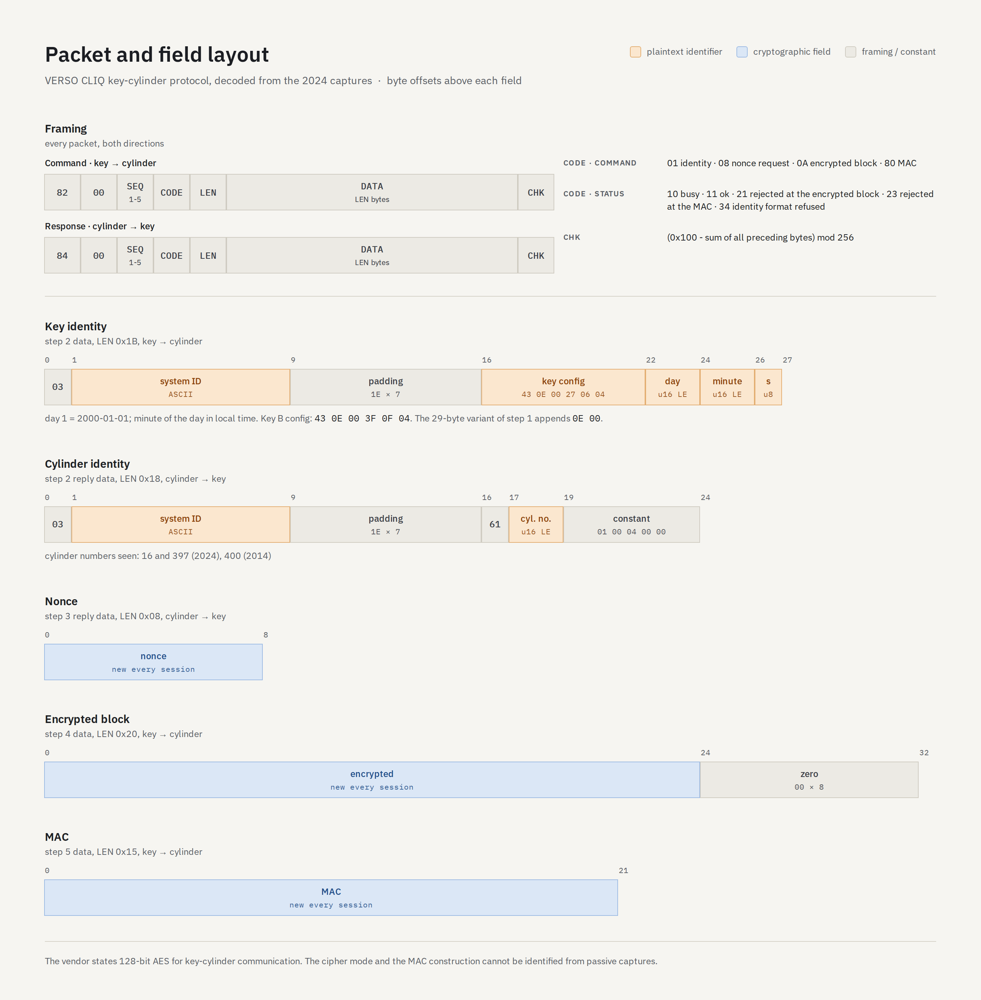
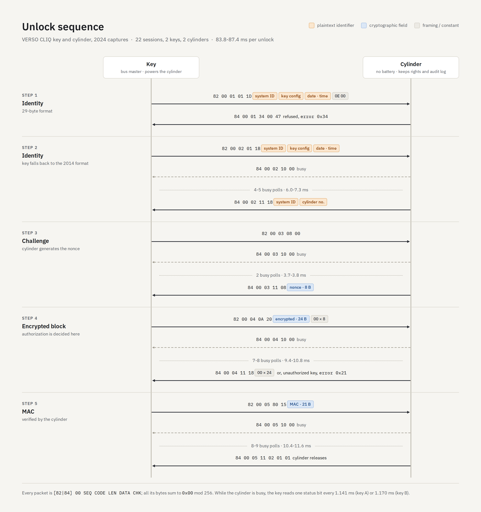

# Protocol Analysis of the ASSA ABLOY VERSO CLIQ Key-Cylinder Interface

> **Research documentation. Read the [Disclaimer](#disclaimer) and [Responsible Disclosure](#responsible-disclosure) before reading further.**

This repository contains a black-box analysis of the contact-based communication between ASSA ABLOY VERSO CLIQ keys and lock cylinders, based on 22 unlock sessions captured in 2024. It covers:

- signal decoding and the complete packet format, including the checksum
- the five-step message flow and how it changed since 2014
- the plaintext fields: system ID, key configuration, the key's date and time, and the cylinder number
- a statistical characterisation of the cryptographic fields
- timing measurements that bound the latency available to a relay attack

It is part two of a master's project at the University of Rostock. Part one, **[1wire-decoder-analysis](https://github.com/towhidulahmed/1wire-decoder-analysis)**, covers the capture setup and first decoding.

---

## Disclaimer

**Purpose.** This repository is published solely for academic study and security-research purposes. It documents the protocol observed on a single deployed CLIQ installation and identifies open research questions. It does **not** contain working exploits, key-recovery tools, unlock-emulation code, or step-by-step instructions for defeating any locking system.

**No responsibility for misuse.** The author assumes no responsibility for any misuse of the information in this repository. Any attempt to defeat a CLIQ system, or any other system, based on this analysis is the sole responsibility of the person undertaking it. Researchers extending this work are expected to comply with all applicable laws and to act in accordance with responsible-disclosure norms. If you discover a working attack, coordinate with the vendor before publishing.

**No affiliation.** This is independent research. It is not affiliated with, sponsored by or endorsed by ASSA ABLOY, IKON or any of their subsidiaries. ASSA ABLOY, VERSO and CLIQ are trademarks of their respective owners and are used here only to identify the system studied.

**Views.** The analysis and conclusions are the author's own. They are not an official statement of the University of Rostock or of the Chair of Information and Communication Services (IuK).

**Scope and accuracy.** The findings describe one installation at the time of capture (2024). Other installations, newer key or cylinder firmware, or later product generations may behave differently. Interpretations of protocol fields are inferred from passive observation and may be incomplete or wrong. This work is not a security certification or product evaluation, and its results should not be used as the basis for purchasing or deployment decisions.

**Data in the captures.** The captures contain identifiers of one installation and the times at which two keys were used (§4). They are published only to make the analysis reproducible. Do not use them to identify, track or profile any person or location.

**No warranty.** The code and data are provided "as is", without warranty of any kind. See the [License](#license) section.

---

## Responsible Disclosure

| Item | Status |
|------|--------|
| System under analysis | ASSA ABLOY VERSO CLIQ, one installation. The system ID is abbreviated as `V1004XXX` in this text; it can be read from the raw captures. |
| Capture period | May to August 2024 (master's pre-thesis, University of Rostock) |
| Disclosure type | **Self-disclosure** of the author's own captured data, for academic study and research |
| Disclosure date | **2026-07-16** |
| Scope | Protocol structure, plaintext fields, statistics of the cryptographic fields, timing. **No key-recovery or unlock-emulation attack is demonstrated.** |
| 2014 comparison data | Decodes produced at the University of Rostock (IuK) in 2014. The files are not redistributed; values needed for the comparison are quoted in §3. For access, contact the IuK chair (see [`data/local_previous_research/`](data/local_previous_research/README.md)). |

---

## Threat Model

**Asset.** The ability to open a specific door protected by a CLIQ cylinder, and the confidentiality of who opened which door when.

| Attacker capability | Status |
|---|---|
| Passive eavesdropping on the key-cylinder contact during a legitimate unlock | Primary scenario. Requires physical access to the contact, i.e. an adapter between key and cylinder or a modified key or cylinder. The captures in this work used an in-line adapter. |
| Active relay of the exchange between a legitimate key and a cylinder | Considered (§6). Requires a fake cylinder that the victim's key is inserted into and a key emulator in the real cylinder. |
| Physical access to a legitimate key (borrowed, stolen briefly) | Considered |
| Power or EM side-channel analysis of key or cylinder | Future work |
| Invasive extraction of secrets from key or cylinder hardware | Out of scope |

**Attacker goals considered:** unauthorized unlock; tracking which key was used where and when; cloning a key; replay or relay.

**What the protocol provides:** a fresh cylinder-generated nonce per session, an encrypted block that the cylinder checks for authorization, and a MAC that the cylinder verifies. The vendor states that all key-cylinder communication is protected with 128-bit AES [V1].

**What it does not provide:** a response deadline or distance bounding (§6); confidentiality of the system ID, key configuration, key clock and cylinder number (§4).

---

## 1. Dataset

All captures were recorded with a Saleae logic analyzer at one installation and exported as CSV.

| Folder | Content | Sessions |
|--------|---------|----------|
| [`data/captures/key_a/`](data/captures/key_a/) | Key A (the author's key) at cylinder 16: 7 sessions on 2024-06-11, 4 on 2024-08-18 (3 before and 1 after the key was re-programmed) | 11 |
| [`data/captures/key_b/`](data/captures/key_b/) | Key B (a second user's key) on 2024-07-16: 5 sessions at cylinder 397, 6 at cylinder 16 | 11 |
| [`data/captures/fragments/`](data/captures/fragments/) | Partial captures: identity packets with wall-clock time (2024-05-28, 2024-08-18 after re-programming) and three wrong-key attempts (2024-08-23) | 9 files |

Every session file is named after the timestamp that the key itself transmits (§4.2). Files exported with absolute timestamps also carry the analyzer's wall-clock time, which §4.2 uses to verify the key clock.

All 22 sessions are distinct recordings: their nonces are all different. The two keys are told apart by their configuration block (§4.1) and by the period of their busy polls (§6), which differ by 2.5 % with no overlap. The two cylinders are told apart by the cylinder number in their reply (§4.3).

> **Relation to earlier versions.** Earlier versions of this repository stored 15 files in `user1_key/`, `user2_key/` and `extas_comparison/`. Three of them were duplicate exports of the same recording, and `user1_key/session_05-08` were in fact recorded with key B. The 12 unique recordings are all included here, together with 10 further sessions from the same capture campaign that had not been decoded before.

### 2014 comparison data

The comparison with 2014 in §3 to §5 uses eight unlock sessions that were recorded and decoded at the same installation in 2014 by the Chair of Information and Communication Services (IuK) at the University of Rostock.

**This data is not included in the repository and is not published here.** Only the few values needed to support a finding are quoted in the text. To obtain the 2014 data, please contact the IuK chair at the University of Rostock: [https://www.iuk.informatik.uni-rostock.de/](https://www.iuk.informatik.uni-rostock.de/).

The folder [`data/local_previous_research/`](data/local_previous_research/README.md) is a placeholder for it. When the data is present there, the analysis scripts add the 2014 comparison to their output; without it, they run on the 2024 captures alone.

---

## 2. Signal and Decoding

| Parameter | Value |
|-----------|-------|
| Logic high voltage | ~2.98 V (key battery) |
| Bit '1' | ~4.3 µs low pulse |
| Bit '0' | ~13.7 µs low pulse |
| Bit slot | ~18.75 µs |
| Bit order | LSB first |

The key is the bus master and powers the cylinder through the contact; the cylinder has no battery [V1].

**Byte framing and busy polls.** While the cylinder computes, the key reads a single status bit from it about every 1.15 ms. These one-bit reads are separated from the bytes around them by idle gaps. The decoder ([`scripts/decode_signal.py`](scripts/decode_signal.py)) splits the signal at every idle gap longer than 150 µs and re-establishes byte alignment after each one. One-bit groups are recorded as busy polls, and the rest are parsed as packets and validated with the length field and checksum. The decoder accepts both relative and absolute (ISO 8601) timestamps.

> An earlier version of the decoder concatenated all bits of a capture. The busy-poll bits then shifted every following byte by 4 bits, so no nonce, encrypted block or MAC was found in the 2024 captures. All results derived from that decoding have been withdrawn (§10).

**Result: 308 of 308 packets in the 22 sessions, and 8 of 8 packets in the fragments, have a consistent length field and a valid checksum. All 22 sessions end in a successful unlock.**

---

## 3. Protocol Structure

### 3.1 Packet format



```
Command  (key -> cylinder):  82 00 SEQ CODE LEN DATA[LEN] CHK
Response (cylinder -> key):  84 00 SEQ STS  LEN DATA[LEN] CHK
```

- `SEQ` numbers the exchange (1-5) and is echoed in the cylinder's responses.
- `CODE`: `01` identity, `08` nonce request, `0A` encrypted block, `80` MAC.
- `STS`: `10` busy, `11` OK with data, other values are errors (`21`, `23` and `34` observed).
- `LEN`: number of data bytes.

### 3.2 Checksum

`CHK` is an 8-bit additive checksum: **all bytes of a packet, including `CHK`, sum to `0x00` mod 256.** The rule holds for every packet in the 2024 captures and for all 84 packets of the 2014 decodes. The 2014 decodes list cylinder responses without the leading `0x84` byte, so their bytes sum to `0x7C = 0x100 - 0x84`, which is the same rule.

The checksum provides error detection only. Earlier attempts to identify it searched CRC-8 parameter spaces, which is why they found nothing.

### 3.3 Message flow



Every 2024 session consists of the same 14 packets in five steps:

| Step | Key sends | Cylinder replies |
|------|-----------|------------------|
| 1 | Identity, 29-byte format (`LEN 0x1D`) | error `0x34` |
| 2 | Identity, 27-byte format (`LEN 0x1B`) | busy, then its own identity block (24 bytes) |
| 3 | Nonce request (`LEN 0`) | busy, then an 8-byte nonce |
| 4 | Encrypted block: 24 bytes plus 8 zero bytes | busy, then 24 zero bytes; for an unauthorized key, error `0x21` |
| 5 | MAC: 21 bytes | busy, then `01 01`; the cylinder releases |

**Identity fallback.** In every 2024 session the key first sends a 29-byte identity packet, which is its 27-byte identity followed by `0E 00`. The cylinder refuses it with status `0x34`, and the key immediately resends the identity in the 27-byte layout, which is accepted. In all eight 2014 sessions the key sends only the 27-byte layout and the flow has four steps (`SEQ` 1-4). The likely explanation is that the keys were updated to a newer protocol version while the cylinders still speak the older one, and the key falls back. Whether a cylinder that supports the 29-byte format can be made to fall back as well is an open question (§9).

**Where authorization is checked.** On 2024-08-23, three attempts with a key not authorized for cylinder 397 all failed in the same way. The cylinder answered the encrypted block with busy and then `84 00 04 21 00 57` (error `0x21`); see [`data/captures/fragments/`](data/captures/fragments/). One 2014 session fails at the same point. The unauthorized key passes the identity and nonce steps, so the cylinder decides on the encrypted block. A second 2014 session is rejected one step later, after the MAC (error `0x23`), so the MAC is verified separately.

**2014 outcomes.** Of the 8 sessions: 3 end in a confirmed unlock, 2 end before the cylinder's final reply was recorded, 1 is rejected after the encrypted block (`0x21`), 1 after the MAC (`0x23`), and 1 is aborted before the nonce is delivered.

---

## 4. Plaintext Fields

### 4.1 Key identity packet (27-byte layout)

| Offset | Bytes | Content | Observation |
|--------|-------|---------|-------------|
| 0 | 1 | `03` | constant |
| 1-8 | 8 | System ID, ASCII `V1004XXX` | constant |
| 9-15 | 7 | `1E` x 7 | constant |
| 16-21 | 6 | Key configuration block | constant per key: key A `43 0E 00 27 06 04`, key B `43 0E 00 3F 0F 04`, 2014 key `41 02 00 08 01 04` |
| 22-23 | 2 | Day counter, 16-bit LE, day 1 = 2000-01-01 | the key's date (§4.2) |
| 24-25 | 2 | Minute of the day, 16-bit LE | the key's local time (§4.2) |
| 26 | 1 | Second | the key's local time (§4.2) |

Bytes 19-20 of the configuration block (`27 06`, `3F 0F`) are the only bytes that distinguish the two keys. They are probably a key number, but this is not confirmed.

### 4.2 The key transmits its date and time

Bytes 22-26 are a timestamp from the key's real-time clock. CLIQ user keys contain such a clock for time-limited access rights and audit trails [V3, V4]. Evidence, from [`scripts/clock_analysis.py`](scripts/clock_analysis.py):

- **Value ranges.** In all 25 identity packets (22 sessions and 3 fragments), the minute field is below 1440 and the second field below 60.
- **Dates.** The day counter matches the capture date in every case: 8915 = 2024-05-28, 8929 = 2024-06-11, 8964 = 2024-07-16, 8997 = 2024-08-18. The capture dates come from the Saleae files' own metadata. The 2014 decodes give 2014-06-04 and 2014-06-11.
- **Wall-clock comparison.** For the 13 packets whose CSV export kept absolute time, key time minus analyzer time is consistent within each occasion:

| Occasion | Key | Samples | Key clock minus analyzer clock |
|----------|-----|---------|--------------------------------|
| 2024-05-28 | A | 2 | -25 to -24 s |
| 2024-06-11 | A | 3 | -2 to -1 s |
| 2024-07-16 | B | 3 | +6 s |
| 2024-08-18, before re-programming | A | 3 | -38 to -37 s |
| 2024-08-18, after re-programming | A | 2 | +14 s |

The jump of about 51 seconds between 19:47 and 19:56 on 2024-08-18 shows that re-programming the key set its clock. The minute field is local time (CEST).

**Consequence.** In every unlock, the key sends its own date and time to the second, together with the system ID and its configuration block, in plaintext. A device on the contact therefore learns which key was used, when, and (from §4.3) at which cylinder. This is the same information as the system's audit trail. The offset of a key's clock is also a weak fingerprint of the key.

### 4.3 Cylinder identity block

The cylinder's reply in step 2 echoes the system ID and padding and ends with `61 [2 bytes] 01 00 04 00 00`. The two bytes are a 16-bit little-endian cylinder number:

| Cylinder number | Seen in |
|-----------------|---------|
| 16 | all key A sessions; key B sessions at 11:08-11:09 on 2024-07-16 |
| 397 | key B sessions at 11:00-11:02 on 2024-07-16; the wrong-key attempts on 2024-08-23 |
| 400 | all 2014 sessions |

Key B's captures were recorded at two doors within ten minutes, and the number changes exactly between them. The cylinder therefore also identifies itself in plaintext.

---

## 5. Cryptographic Fields

### 5.1 What is known

| Field | Length | Observation |
|-------|--------|-------------|
| Nonce (step 3) | 8 bytes | Generated by the cylinder; different in every session |
| Encrypted block (step 4) | 24 + 8 bytes | The 24 bytes change every session; the 8 trailing bytes are always zero. The cylinder decides authorization on this block (§3.3). |
| MAC (step 5) | 21 bytes | Changes every session; verified by the cylinder |

The vendor states that "all electronic communications between a CLIQ key and the chip inside a CLIQ cylinder are masked with AES encryption" and lists 128-bit AES [V1]. Passive captures cannot confirm this or identify the construction:

- **Uniformity says nothing about the algorithm.** Any secure cipher or MAC produces output that looks random.
- **The MAC length does not point to a known construction.** At 21 bytes (168 bits) it is not the output size of any common primitive; it may be a 20-byte value plus one byte, or a truncated construction.
- **The 24 + 8 byte layout fits several AES modes.** The data cannot distinguish them.

### 5.2 Statistical characterisation

From [`scripts/statistical_analysis.py`](scripts/statistical_analysis.py), over the 22 sessions:

| Field | Unique | Fraction of one-bits (z vs 0.5) | Biased bit positions (Bonferroni) | Mean pairwise Hamming distance | Constant byte positions |
|-------|--------|---------------------------------|-----------------------------------|--------------------------------|-------------------------|
| Nonce (64 bit) | 22/22 | 0.465 (z = -2.61) | 0 of 64 (smallest p = 0.019) | 49.4 % | none |
| Encrypted 24 bytes (192 bit) | 22/22 | 0.523 (z = +2.95) | 0 of 192 (smallest p = 0.0014) | 49.8 % | none |
| MAC (168 bit) | 22/22 | 0.497 (z = -0.36) | 0 of 168 (smallest p = 0.0056) | 49.9 % | none |

The aggregate one-bit fractions of the nonce and the encrypted block deviate from 0.5 by more than chance at this sample size would usually produce (|z| > 2.39 with Bonferroni over three fields). However:

- **The deviation is not localised.** No single bit position is biased after correction.
- **The 2014 sample leans the other way.** Its nonces deviate in the opposite direction (0.567, z = +2.83, n = 7), and its encrypted blocks are balanced (0.490).
- **The pooled data are within or near chance.** For 2014 and 2024 combined, the nonce gives z = -0.88 and the encrypted block z = +2.20.

This pattern is not evidence of a weakness, but it should be re-tested with more captures.

| Further test | Result |
|--------------|--------|
| Constant byte positions within one key (encrypted block, MAC) | none for either key |
| First 8 encrypted bytes XOR nonce constant per key (keystream reuse) | no: all values distinct for both keys |
| MAC Hamming distance, same key vs different key | 50.2 % (110 pairs) vs 49.6 % (121 pairs) |
| Nonce-to-MAC byte correlations (168 tests) | 13 with uncorrected p < 0.05 (8.4 expected), none after Bonferroni |
| Nonce-to-encrypted-block byte correlations (192 tests) | 11 with uncorrected p < 0.05 (9.6 expected), one after Bonferroni: nonce[2] vs block[8], r = -0.78. It does not replicate in the independent 2014 sample (r = +0.38, n = 7) and is most likely a false positive. |
| Values shared between 2014 and 2024 | none (nonce, encrypted block, MAC) |

The p-values are exact (Student's t via the regularized incomplete beta function). At n = 22 with Bonferroni correction, the smallest correlation detectable with 80 % power is |r| ≈ 0.77, so these tests can only exclude gross linear leakage.

**Interpretation.** No weakness is visible in the cryptographic fields at this sample size: there are no constant positions, no keystream reuse, no repeated values, no key dependence of MAC distances, and no replicated correlation. This is a negative result with limited power, not evidence of strength.

---

## 6. Timing and Relay Feasibility

From [`scripts/timing_analysis.py`](scripts/timing_analysis.py):

| Key and cylinder | Sessions | Exchange duration | Busy-poll period |
|------------------|----------|-------------------|------------------|
| Key A at cylinder 16 | 11 | 83.8-85.0 ms | 1.1409 ms (sd 0.0005) |
| Key B at cylinder 16 | 6 | 86.2-87.4 ms | 1.1700 ms (sd 0.0001) |
| Key B at cylinder 397 | 5 | 84.9-86.1 ms | 1.1699 ms (sd 0.0001) |

| Key waits after | Busy polls | Wait time |
|-----------------|------------|-----------|
| Identity (step 2) | 4-5 | 6.0-7.3 ms |
| Nonce request | 2 | 3.7-3.8 ms |
| Encrypted block | 7-8 | 9.4-10.8 ms |
| MAC | 8-9 | 10.4-11.6 ms |

The exchange takes about 85 ms, which is consistent with the release delay of "approx. 0.1 seconds" in the vendor's user instructions [V2]. The busy-poll period depends only on the key, which confirms that the key generates it.

**The key does not impose a fixed response deadline.** It polls until the cylinder is ready, and the number of polls for the same step varies between sessions (4 or 5 after identity, 7 or 8 after the encrypted block). A relay therefore does not have to answer within one bit slot. The fake cylinder holding the victim's key can answer the key's polls with "busy" until the reply from the real cylinder arrives, which hides the forwarding latency inside the poll loop. The available budget per step is at least the observed variation (one poll, about 1.15 ms) and at most the key's unknown abort timeout.

Together with the absence of distance bounding, this makes a relay attack plausible. It has **not** been demonstrated. The decisive measurement is how many busy polls the key tolerates before aborting (§9).

---

## 7. Identified Weaknesses

| # | Observation | Severity | Relevance |
|---|-------------|----------|-----------|
| 1 | No response deadline; busy polling absorbs variable latency; no distance bounding | High if the key's timeout is long | Relay attack (§6) |
| 2 | Key date and time to the second sent in plaintext in every unlock | Medium | Reveals when each key is used; duplicates the audit trail |
| 3 | System ID, key configuration block and cylinder number in plaintext | Medium | Identifies installation, key and door |
| 4 | Key falls back from the 29-byte to the 27-byte identity format on error | Unknown | Possible downgrade path (§3.3) |
| 5 | Distinct error statuses (`0x21` after the encrypted block, `0x23` after the MAC, `0x34` for the identity format) | Low | Reveals which check failed |
| 6 | Busy-poll period (1.1409 vs 1.1700 ms) and clock offset differ per key | Low | Passive key fingerprinting |

---

## 8. Limitations

1. **Sample size.** 22 sessions from 2 keys, 2 cylinders and 1 installation. The statistical tests can only exclude gross leakage (§5.2).
2. **Passive captures only.** No chosen nonces, modified messages or fault injection. The cipher and MAC constructions cannot be identified.
3. **Single installation and firmware generation.** Generalisation to other CLIQ systems is unverified.
4. **Inferred semantics.** The meaning of the configuration block and of the status codes is inferred. The timestamp and cylinder-number interpretations are supported by independent evidence (§4.2, §4.3).
5. **Relay not demonstrated.** Feasibility rests on the timing structure; the key's abort timeout is unmeasured.
6. **Unexported recordings.** Several recordings exist only as Saleae `.sal` files and have not been decoded: May 2024 sessions, the complete 2024-05-28 sessions, a failed session on 2024-05-28, and the full wrong-key recordings of 2024-08-23. Exporting them to CSV would extend the dataset.
7. **Analyzer clock.** The wall-clock comparison in §4.2 assumes that the capturing computer's clock was correct to within a second.

---

## 9. Future Work

| Experiment | Question answered |
|------------|-------------------|
| Delay the cylinder's replies with a man-in-the-middle device and count the busy polls the key tolerates | The relay latency budget; whether a relay is practical |
| Build a two-device relay prototype with timing instrumentation | Demonstrates or refutes the relay attack |
| Change the timestamp in the identity packet in transit and read the cylinder's audit trail | Whether the key's time is authenticated, and whether audit entries can be falsified |
| Capture a cylinder that accepts the 29-byte identity | The meaning of the newer format; whether a downgrade is possible |
| Export the remaining `.sal` recordings; capture more keys and installations | Larger sample; which fields are installation-specific |
| Power or EM traces during the encrypted-block and MAC steps | Side-channel leakage (cf. [R5], [R7]) |

---

## 10. Corrections to Earlier Versions

The version of this README published before this revision contained claims that do not hold once the captures are decoded correctly:

| Earlier claim | Correction |
|---------------|-----------|
| MAC is SHA-1 from a Maxim DS28EC20 (`Compute MAC`), "high confidence" | The DS28EC20 is a plain 20 Kb 1-Wire EEPROM without a SHA-1 engine or MAC command [D1], and its commands do not match the observed codes. The MAC construction is unknown. |
| MAC is 22 bytes (20 B SHA-1 + 2 B device status) | The MAC field is 21 bytes (`LEN 0x15`). The 22nd byte is the packet checksum. |
| AES mode narrowed down from the 24 + 8 byte layout | AES-128 is the vendor's statement [V1]. The layout fits several modes, and passive data cannot identify the mode. |
| Trailing byte unidentified after a CRC-8 search | It is an 8-bit additive checksum (§3.2). |
| Bytes 27-28 identify the key; bytes 29-33 are a counter or session value | Identity bytes 22-26 are the key's date and time (§4.2). The keys differ in the configuration block. |
| 2014 data from two different keys | All eight 2014 sessions are from one key at one cylinder (number 400), on two days. |
| 23 captured sessions | 22 unique sessions from 2024 in this repository. The 15 files of the earlier version contained 12 unique recordings. |
| `user1_key` and `user2_key` hold the two users' sessions | `user1_key/session_05-08` were recorded with key B. |
| Unlock takes ~7.6 ms; ~255 bytes per session | The exchange takes 83.8-87.4 ms. The byte count was an artefact of the decoder. |
| Protocol unchanged for 10 years | The 2024 key adds a 29-byte identity attempt, and the steps are renumbered (§3.3). The 27-byte layout is still accepted. |
| Avalanche, entropy-map and same-key/cross-key results | They were computed at fixed byte offsets of misaligned data that did not contain the nonce or MAC. Replaced by §5.2. |

---

## Repository Structure

```
+- assets/
|  +- protocol_flow.png        # Unlock sequence diagram (generated from the captures)
|  +- packet_format.png        # Packet framing and byte-level field layout
+- data/
|  +- captures/
|     +- key_a/                # 11 sessions, files named by the key's own timestamp
|     +- key_b/                # 11 sessions
|     +- fragments/            # identity packets with wall-clock time, wrong-key rejections
+- scripts/
|  +- decode_signal.py         # Signal -> validated packets (gap-based byte framing)
|  +- sessions.py              # Packets -> session records (fields, timestamp, cylinder, timing)
|  +- protocol_analysis.py     # Packet format, checksum, flow, wrong-key rejections, 2014 comparison
|  +- clock_analysis.py        # Key timestamp decoding and wall-clock comparison
|  +- timing_analysis.py       # Durations, busy polling, per-key timing
|  +- statistical_analysis.py  # Field statistics, correlation and power analysis
|  +- generate_images.py       # Figures in assets/
+- README.md
```

## Running the Analysis

The analysis scripts need Python 3 and only the standard library:

```bash
python3 scripts/decode_signal.py data/captures/key_a/2024-06-11_17-39-27.csv   # one capture, packet by packet
python3 scripts/protocol_analysis.py
python3 scripts/clock_analysis.py
python3 scripts/timing_analysis.py
python3 scripts/statistical_analysis.py
```

Each analysis script writes a `*_results.json` file to the repo root; these files are not tracked. The figures are laid out in HTML from the decoded sessions and rendered to PNG with headless Chromium:

```bash
pip install playwright
python3 -m playwright install chromium
python3 scripts/generate_images.py          # --html also writes the HTML sources
```

The 2014 comparison runs only if the 2014 decodes are present in `data/local_previous_research/`. That data is not published; [its README](data/local_previous_research/README.md) explains how to request it from the IuK chair.

## Acknowledgments

**Previous research:** University of Rostock, Faculty of Computer Science and Electrical Engineering, Chair of Information and Communication Services (IuK), [https://www.iuk.informatik.uni-rostock.de/](https://www.iuk.informatik.uni-rostock.de/), for the 2014 protocol decodes used as a reference.

**Initial signal analysis and protocol decoding:** [1wire-decoder-analysis](https://github.com/towhidulahmed/1wire-decoder-analysis)

## License

Code in `scripts/`: **MIT License** (see [`LICENSE`](LICENSE)).

Analysis text in this README: **CC-BY-4.0**.

The capture data under `data/captures/` is the author's own work and is released under **CC0 1.0** (public domain dedication), subject to the responsible-disclosure caveats in [§Responsible Disclosure](#responsible-disclosure).

## References

**Vendor and component documentation**

- [V1] ASSA ABLOY, *CLIQ cylinders*, product page, [assaabloy.com](https://www.assaabloy.com/lv/en/solutions/products/access-control/cliq/cliq-cylinders) (accessed 2026-10-26).
- [V2] ASSA ABLOY Sicherheitstechnik, *VERSO CLIQ User instructions*, document P845131_0K.
- [V3] IKON / ASSA ABLOY, *VERSO CLIQ* product brochure, WS8230, 06/2019 (key variants E1 basic, E2 time, E3 remote; cylinder event memory).
- [V4] ASSA ABLOY, *CLIQ wall programming device*, product page, [assaabloy.com](https://assaabloy.com/group/emeia/solutions/products/digital-access-solutions/cliq/cliq-programming-devices/wall-programming-device) (revalidation of time schedules and access rights).
- [D1] Analog Devices (Maxim Integrated), *DS28EC20 20Kb 1-Wire EEPROM*, datasheet.

**Research**

- [P1] M. T. Ahmed, *Forwarding-Attack on a Mechatronic Locking System*, master's pre-thesis, University of Rostock, 2024.
- [R1] M. W. Tobias, M. Fiddler, T. Bluzmanis, *Invisible Access: Opening New Doors to Insecurity*, DEF CON 17, 2009.
- [R2] Boing Boing, report on the DEF CON 17 lock demonstrations, 2009-08-02, [boingboing.net](https://boingboing.net/2009/08/02/cliq-and-other-unpic.html/amp).
- [R3] M. Weiner, M. Massar, E. Tews, D. Giese, W. Wieser, *Security Analysis of a Widely Deployed Locking System*, ACM CCS 2013.
- [R4] D. Strobel, B. Driessen, T. Kasper, G. Leander, D. Oswald, F. Schellenberg, C. Paar, *Fuming Acid and Cryptanalysis: Handy Tools for Overcoming a Digital Locking and Access Control System*, CRYPTO 2013, LNCS, pp. 147-164, doi:10.1007/978-3-642-40041-4_9.
- [R5] D. Oswald, D. Strobel, F. Schellenberg, T. Kasper, C. Paar, *When Reverse-Engineering Meets Side-Channel Analysis: Digital Lockpicking in Practice*, SAC 2013, LNCS, pp. 571-588, doi:10.1007/978-3-662-43414-7_29.
- [R6] L. Wouters, I. Carroll, et al., *Unsaflok*, disclosure of vulnerabilities in dormakaba Saflok locks, March 2024, [unsaflok.com](https://unsaflok.com).
- [R7] D. Oswald, *Side-Channel Attacks on SHA-1-Based Product Authentication ICs*, CARDIS 2015, LNCS, pp. 3-14, doi:10.1007/978-3-319-31271-2_1.
- [R8] P. Moravec, M. Krumnikl, *Developing Countermeasures against Cloning of Identity Tokens in Legacy Systems*, CISIM 2017, LNCS, pp. 672-684, doi:10.1007/978-3-319-59105-6_58.
- [R9] L. A. Magre Colorado, J. C. Martínez-Santos, *Leveraging 1-wire Communication Bus System for Secure Home Automation*, in *Advances in Computing* (CCC 2017), Communications in Computer and Information Science, Springer, pp. 759-771, doi:10.1007/978-3-319-66562-7_54.
- [R10] G. P. Hancke, *A Practical Relay Attack on ISO 14443 Proximity Cards*, technical report, 2005.
- [R11] A. Francillon, B. Danev, S. Capkun, *Relay Attacks on Passive Keyless Entry and Start Systems in Modern Cars*, NDSS 2011.
- [R12] F. D. Garcia, D. Oswald, T. Kasper, P. Pavlidès, *Lock It and Still Lose It: On the (In)Security of Automotive Remote Keyless Entry Systems*, USENIX Security 2016.
- [R13] S. Brands, D. Chaum, *Distance-Bounding Protocols*, EUROCRYPT 1993, LNCS 765, pp. 344-359.
- [R14] G. P. Hancke, M. G. Kuhn, *An RFID Distance Bounding Protocol*, SecureComm 2005, pp. 67-73.

---

*Maintained by Md Towhidul Ahmed. Pull requests that extend the analysis (especially timing measurements, captures from other installations, or side-channel work) are welcome. Pull requests that publish working key-recovery or unlock-emulation code will not be merged without documented vendor coordination.*
